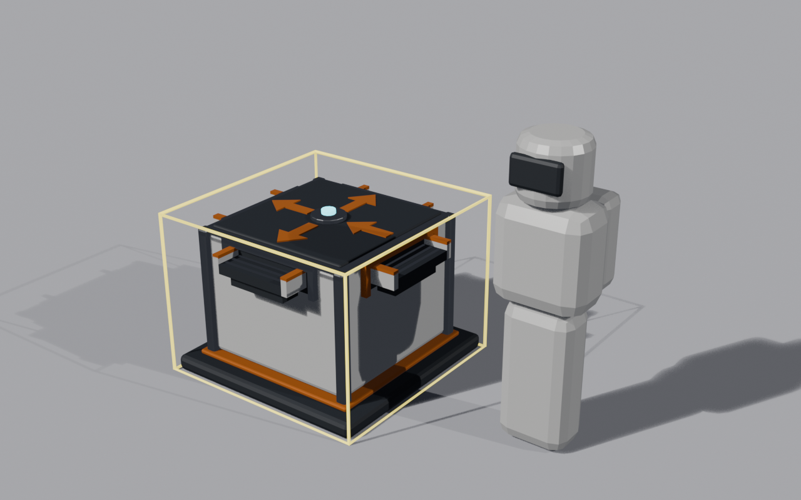
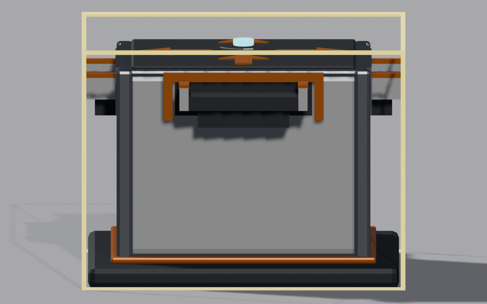
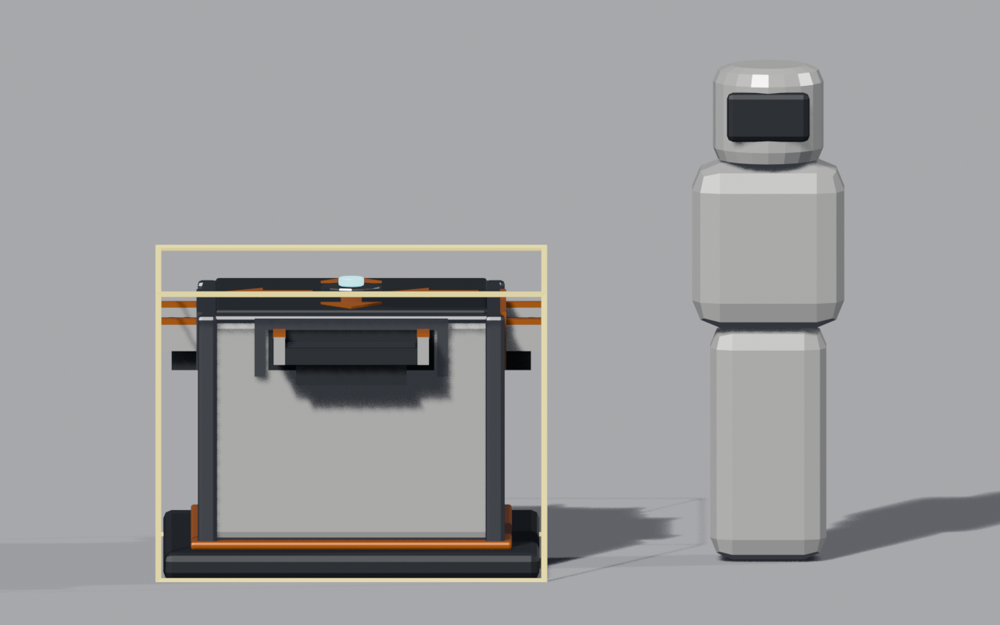
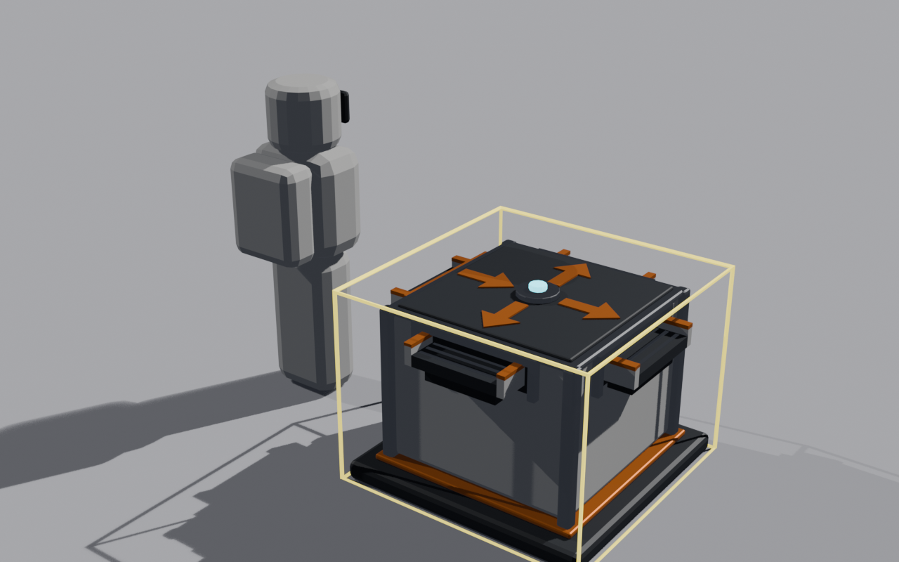
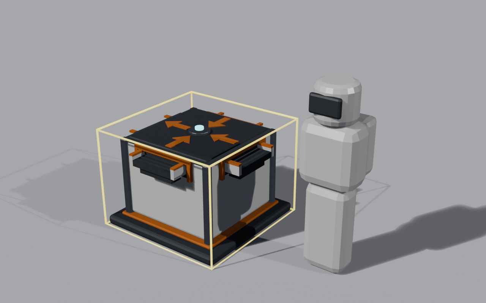
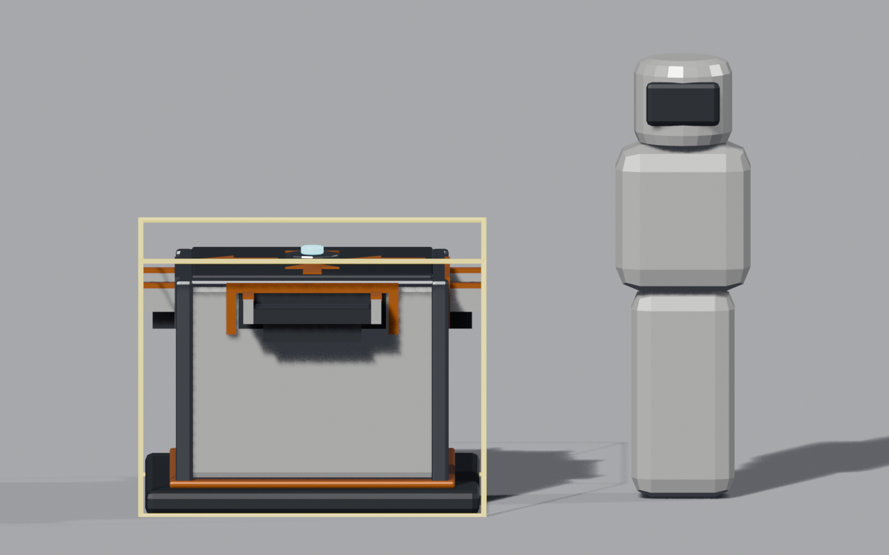
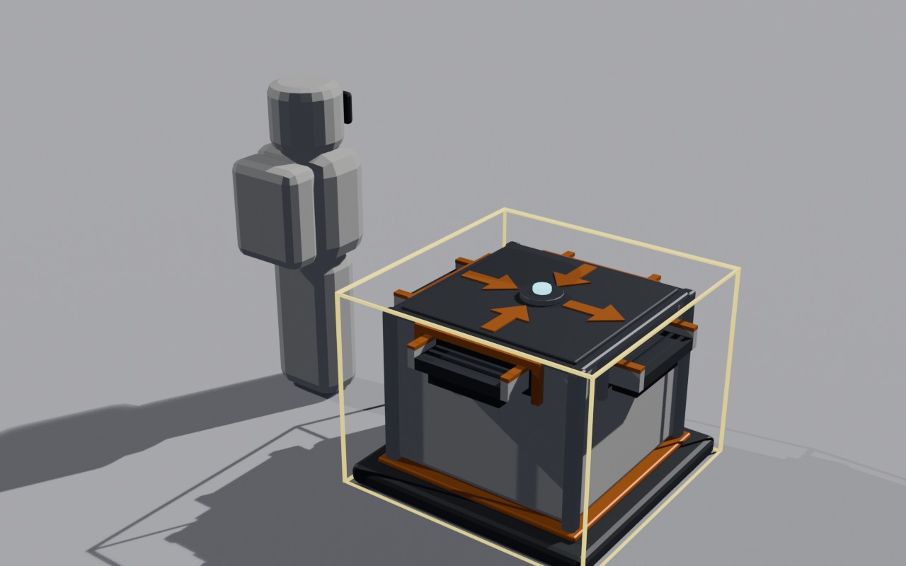

# Belt Boxes

A compact box splitter and box merger for belts: one belt in, up to three out, or up to three in, one out. Any cargo
passes, vanilla or modded. Built on [StructureLib](../../src/StructureLib/README.md) (its routers), which must be
installed too.

By ryanhartwig.

## What it adds

| | Numbers |
|---|---|
| **Box splitter** (Logistics, $25) | A 1.4 m square box. One belt in, up to three belts out (forward, left, right). Each canister goes to the next output in turn; an output that has no belt or whose belt entrance is blocked is skipped. When no output can take a canister it waits at the end of the input belt, and the belt queues behind it. |
| **Box merger** (Logistics, $25) | The same box. Up to three belts in (left, back, right), one belt out. It serves the inputs in turn among those with a canister waiting; when the output belt is missing or blocked, everything waits. |

Note in the build menu:

- Box splitter: "Splits one belt into up to three, taking turns. Skips an output that is blocked or has no belt."
- Box merger: "Merges up to three belts into one, taking turns."

The vanilla splitter costs $5; these cost a little more as a convenience: they take side belts, which the vanilla Y
does not. Canisters keep their cargo, kilograms, capacity and owner through a box. The rate is bounded by the output
belt's entrance spacing.

## Ports

The ports come from the models: each is a `Port_<name>` node in `box_splitter.bin` or `box_merger.bin`, not a list in
the code. Flow runs along the box's +X axis (the way the game's own machines run). Left and right are as seen looking
along +X, standing up. Positions are structure-local, in metres, on the footprint edge at belt height.

The turn order is the order StructureLib resolves the ports in, which for a model's ports is their order in the file,
and the exporter writes them alphabetically. So the splitter's outputs take turns Forward, Left, Right, and the merger
serves its inputs Back, Left, Right. The table is in that order.

| Box | Port | Where (x, y, z) | Belt flows |
|---|---|---|---|
| Box splitter | `Forward` (output, 1st) | (0.70, 0.85, 0.00), the front face | +X, away from the box |
| Box splitter | `In` (input) | (−0.70, 0.85, 0.00), the back face | +X, into the box |
| Box splitter | `Left` (output, 2nd) | (0.00, 0.85, 0.70), the left face | +Z, away from the box |
| Box splitter | `Right` (output, 3rd) | (0.00, 0.85, −0.70), the right face | −Z, away from the box |
| Box merger | `Back` (input, 1st) | (−0.70, 0.85, 0.00), the back face | +X, into the box |
| Box merger | `Left` (input, 2nd) | (0.00, 0.85, 0.70), the left face | −Z, into the box |
| Box merger | `Out` (output) | (0.70, 0.85, 0.00), the front face | +X, away from the box |
| Box merger | `Right` (input, 3rd) | (0.00, 0.85, −0.70), the right face | +Z, into the box |

## Two differences from the vanilla splitter and merger

- **No cut-in.** StructureLib does not implement dropping a box onto an existing belt to split it. Place the box
  free-standing and join belts to its ports. (The game may still offer cut-in on a placed box; see "Not checked
  yet" below.)
- **No visible crossing.** A canister does not ride across the box: it vanishes at the end of the input belt and a new
  canister (with a new id) appears at the start of the output belt in the same frame.

## Laying one out

- The straight path, splitter `In` → `Forward` and merger `Back` → `Out`, has no turning limit: boxes in a line along
  +X join with short straight belts (1.3 m between boxes worked in game).
- Side belts need room to swing. A U-turn from a side output to the next box's side input, with 1.3 m between the
  boxes, is refused by the game as "Turn too tight: give it more room." (StructureLib's spike planned belts of 6.86 m
  and 5.56 m there; both were routable but never valid). With 5 m between the boxes, both side U-belts (splitter
  `Left` → merger `Left`, `Right` → `Right`) built, 9.81 m each. Otherwise turn the box a side belt feeds so the belt
  runs straight out of the side port.
- Unported faces take nothing.
- The turn is kept in memory only: it starts again from the first port after a load. Building or removing belts and
  structures elsewhere keeps it.

## Co-op

As for any StructureLib belt input: the host decides where canisters go. Clients are untested. StructureLib refuses a
join when the two players' mods differ, so both players need Belt Boxes.

## What works, and what does not yet

### What the self-test proved

StructureLib's dev self-test (`beltboxes-*` checks, single player, slot-2) built a chain from its example grinder
through both boxes into its example burner: grinder → splitter `In`; splitter `Forward`, `Left`, `Right` → merger
`Back`, `Left`, `Right`; merger `Out` → burner. The run ended `45 passed, 0 failed`, with no exception and no failed
save. It showed:
- **Registration.** Both boxes register as routers (a splitter with 1 input and 3 outputs, a merger with 3 inputs and
  1 output), with four ports each and a 1.4 × 1.4 m footprint.
- **Models.** Each placed box shows its own model, the floodlight's meshes are hidden, and one box collider covers the
  footprint. Every port sits at its model node.
- **Even split.** Of the first 12 hops through the splitter, each output took 4, in the order Forward, Left, Right,
  repeated.
- **Fair merge.** With all three merger inputs backed up, the next six hops came from each input twice, in turn
  (Right, Back, Left, Right, Back, Left).
- **Nothing lost.** Grit in (the grinder's 12 kg plus 11 kg the test added) equalled grit out: 13 kg into the burner
  and 10 kg riding the belts.
- **Heavy canisters.** A 3 kg grit canister went through whole: it came out as 3 kg, capacity 3.
- **Skipping.** With the `Forward` belt removed, the splitter sent the next six canisters to `Left` and `Right` only,
  and as many left the input belt as hopped.
- **Saving a full chain.** A save with canisters waiting at the splitter's input and on all three middle belts wrote
  cleanly. It recorded both boxes and all 37 grit canisters on the belts.
- **Removing a box.** The merger was removed while a canister waited at its `Back` input. Nothing threw, every belt
  stayed, and the canister stayed waiting at the open end of its belt.
- **Reload.** In the next launch the splitter came back with its model, along with all five belts and all 38 grit
  canisters from the save. The merger was not saved, because the game saved again right after it was removed. Once the
  canister at each open belt end was taken off, the splitter routed again at once.

### Not checked yet, by hand, worth a look before a release

- **Belts placed by hand** with the belt tool onto each port at the 0.7 m port spacing, side ports included. That
  includes whether a belt can leave or enter every ported face straight. The self-test builds belts through the game's
  `TryBuildConveyor`, never the tool.
- **Cut-in offers.** The game decides whether a structure is a router (`MoonWorld.Routes`) from its definition's ports,
  so it treats any clone with three or four ports, these boxes included, as a router. The belt tool may offer cut-in
  on a placed box, and the other `Routes`-gated paths in the game are untested. StructureLib's own hop answers first
  for a box's input belts, which is what the self-test exercised.
- **The models in real lighting**, at player scale.
- **Removing a box or a belt by hand mid-traffic** with the remove tool. The self-test removed them through the game's
  own calls. A removed belt drops its canisters on the ground in its path, and a new belt there is refused ("Blocked by
  an object.") until they are picked up.
- **Building from the build menu by hand** (the real ghost and the remove tool).
- **Co-op** with two players.

## The models

Each box has its own model: `box_splitter.bin` and `box_merger.bin`, which ship next to `BeltBoxes.dll`. They are built
from the scripts in [`blender/`](blender) (`box_splitter.py`, `box_merger.py` and the shared `box_common.py`).

The box is a white body on a dark skid, with a dark lid. Every ported face has a short belt stub at deck height. An
input's mouth has an orange lip, and an output's has a steel lip. The orange arrows on the lid show the flow: one in and
three out on the splitter, three in and one out on the merger. The model fits the 1.4 m footprint and stands about 1.0 m
tall.

| | Hero | Side | Front | Rear |
|---|---|---|---|---|
| Box splitter |  |  |  |  |
| Box merger |  |  |  |  |

The model's ports are its `Port_*` nodes (see [Ports](#ports)).

## Saves

The boxes are kept in `structurelib.json` next to the save, not in the save itself; their belts are vanilla belts and
the canisters ride the belts. Remove Belt Boxes and the boxes wait in that file until you reinstall it.

## Changelog

- 0.1.0: first version: the box splitter and box merger, with their own models.
