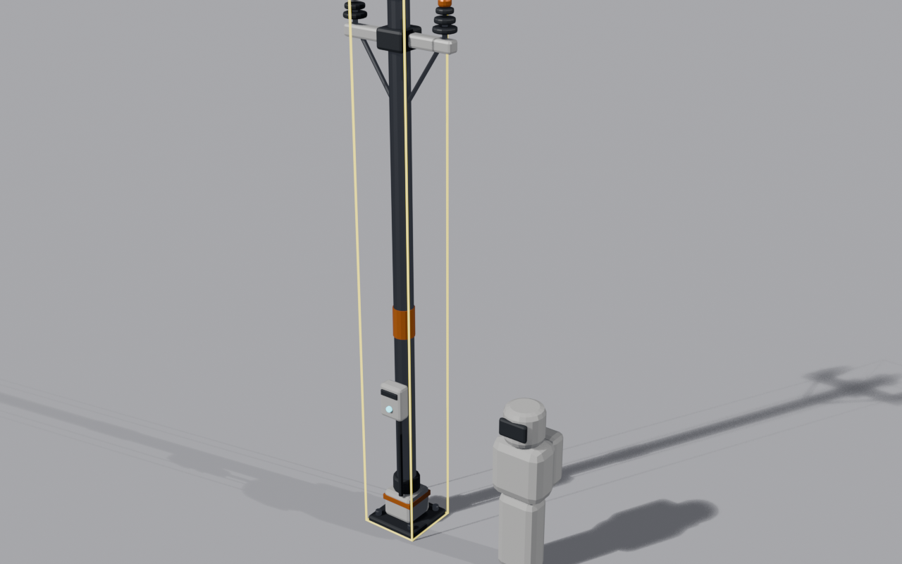
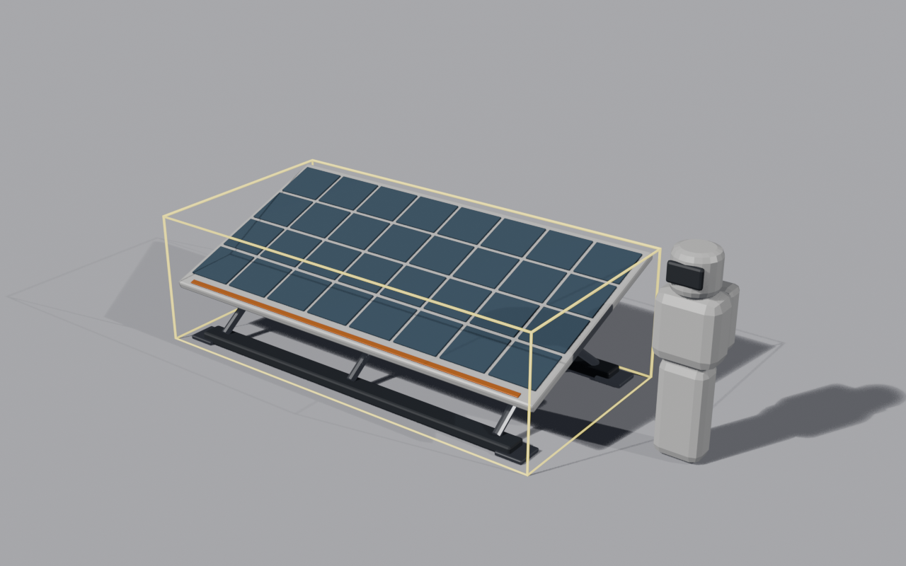
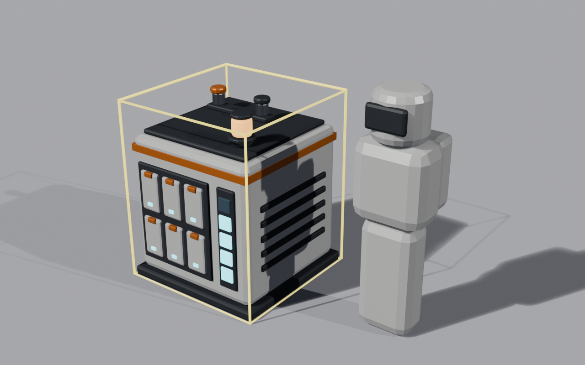

# PowerGrid

A power pole, a solar array and a battery bank: the pieces of a power grid for modded machines.
Requires [StructureLib](../../src/StructureLib/README.md), which must be installed too (the modpack ships both).

## What it adds

| Structure | Id | Price | What it does |
|---|---|---|---|
| **Power pole** | `ryanhartwig.power-pole` | $50 | Links to other poles within 24 m and powers machines within 12 m. Grids pool every source and share the load evenly. |
| **Solar array** | `ryanhartwig.solar-array` | $180 | 10 kW at full sun into the power grid. Needs a power pole within 12 m. |
| **Battery bank** | `ryanhartwig.battery-bank` | $300 | Stores 20 kWh for the grid, 10 kW in or out. Needs a power pole within 12 m. |

All three are in the Power tab.

## How a grid works

Poles link to each other within `LinkRange`, and a pole powers machines, sources and banks within `SupplyRadius`; linked poles form one grid.
A grid pools every source on it and shares the load evenly, Factorio style, so every machine gets the same fraction of what it asks for.
Supply order is solar first, then battery banks, then fuel generators (such as SandPower's coalite furnace), which burn only when the grid still has a deficit.
The game's own solar panels are untouched: the grid tops up whatever they leave unmet.

## Config

`BepInEx/config/com.ryanhartwig.powergrid.cfg`, section `[Grid]`:

| Key | Default | Meaning |
|---|---|---|
| `LinkRange` | 24 | How far a pole links to other poles, in metres. |
| `SupplyRadius` | 12 | How far a pole powers machines, in metres. Must not exceed `LinkRange`. |

If either is 0 or less, or `SupplyRadius` is larger than `LinkRange`, the mod logs a warning naming both values and uses 24 and 12.

## The models

Built with `shared/blender` (scripts in [`blender/`](https://github.com/Andrew1431/MoonSweepers-GarageLib/tree/structurelib/mods/PowerGrid/blender)); the `.bin` files ship next to `PowerGrid.dll`.

- **Power pole** (`power_pole.bin`): a base plate, a 5 m mast and a cross-arm with two insulators.
  
- **Solar array** (`solar_array.bin`): a 4 x 2 m dark-glass panel tilted 20 degrees on an A-frame.
  
- **Battery bank** (`battery_bank.bin`): a 1.2 m cube of cells with a charge lamp.
  

## Requires

StructureLib. In the modpack (`modpack.json`) PowerGrid is listed after StructureLib and before SandPower.

## Changelog

- 0.1.0: first version: the power pole, solar array and battery bank.
