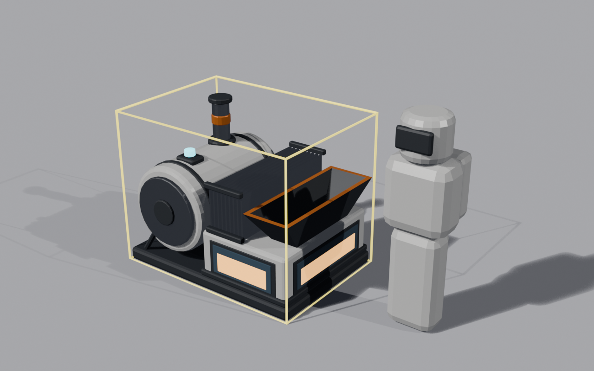

# SandPower

A coking oven that bakes moon sand into coalite, and a coalite furnace that burns it for power.
Built on [StructureLib](../../src/StructureLib/README.md), which must be installed too.

Coalite is regolith sand baked into dense bricks that burn hot in the furnace's oxygen-fed firebox.

## What it adds

| | Numbers |
|---|---|
| **Coalite** (cargo) | 2 kg per unit, sells for $7 per unit. Cargo value 3 (see [the cargo registry](../../docs/cargo-registry.md)). Shown as a sand-coloured brick (its own model, `coalite.bin`) on belts, on the ground and in the hand, in place of the game's dust capsule. |
| **Coking oven** (Production, $800) | Built on the stone press's footprint, with its own model. Holds 16 kg of sand, bakes 4 kg per 8 s cycle at 12 kW. Mass is kept: 4 kg of sand becomes 4 kg of coalite (2 units). The output slot holds 10 kg. |
| **Coalite furnace** (Power, $1,500) | Built on the solar post's footprint, with its own model. Holds 10 kg of coalite (5 units) and burns one 2 kg lump of coalite per 20 s cycle. Each burn adds 3 kWh to its 6 kWh battery (half of it), so two lumps fill it; no burn starts while the battery is full. Supplies up to 10 kW to machines within 24 m, wirelessly: StructureLib machines and vanilla ones (a vanilla machine draws what its own solar grid leaves unmet), with a power arc drawn to each while the build tool is held. Its look-at panel shows its own output, battery, fuel and what it powers. |

The generator alone runs an oven at 10 of its 12 kW (power 0.83, seen in game): a cycle takes 8 s at full power,
so at 0.83 about 9.6 s (derived, not timed). On a
vanilla solar grid the oven draws from the grid's surplus first, then from generators in range, then from the
grid's batteries.

The generator is built on the solar post rather than the battery bank, because the battery bank prefab has no
production view (the part of a model that runs a machine).

## Belting it

Both machines take belts at their ports, like the game's own machines. Belts flow along each machine's long axis:
the input is at one end, the output at the other, so put the machine that feeds another on that machine's input side.

| Machine | Port (as the game shows it) | Where (structure-local, metres) | Takes / gives |
|---|---|---|---|
| Coking oven | `Sand in` ("Coking oven input") | (−4.10, 0.85, 0.00), the black hopper | Takes **moon sand** only, into its 16 kg sand slot. Any other canister waits at the end of the belt. |
| Coking oven | `Coalite out` ("Coking oven output") | (3.90, 0.85, 0.00), the steel chute | Gives **coalite**, one 1 kg canister about every 0.7 s while the belt's entrance is clear. |
| Coalite furnace | `Coalite in` ("Coalite furnace input") | (−0.90, 0.85, 0.00), the black hopper over the firebox | Takes **coalite** only, into its 10 kg slot. |

A full chain: a pressure chamber's sand output belted into the oven's `Sand in`, and the oven's
`Coalite out` belted into the generator's `Coalite in`. Nothing is loaded by hand. Checked in game (StructureLib's
self-test `sandpower-chain`, single player): 12 kg of dust loaded into the chamber, all 12 kg of sand rode into the
oven, its coalite rode into the generator, and the generator charged:

| From the chamber's dust load | Seconds |
|---|---|
| First sand canister on the belt | 12.0 |
| First sand into the oven | 14.7 |
| First oven cycle done | 24.8 |
| First coalite emitted | 25.1 |
| First coalite into the generator | 27.0 |
| First generator charge (3 kWh) | 47.7 |

The chain ran beside a vanilla solar tracker (the oven at full power from the tracker's grid). The belts, the
coalite canisters on them and both machines' contents came back after a save and reload.

## The models

Both machines have their own models (built with `shared/blender`, scripts in [`blender/`](https://github.com/Andrew1431/MoonSweepers-GarageLib/tree/structurelib/mods/SandPower/blender)), shown in place of
the stone press and the solar post; the base structure's colliders and footprint stay.

- **Coking oven** (`coking_oven.bin`): a white press housing on a black skid, sand hopper at the input end,
  coalite chute at the output end.
  
  Views: [hero](https://raw.githubusercontent.com/Andrew1431/MoonSweepers-GarageLib/structurelib/mods/SandPower/blender/preview_oven_hero.png), [side](https://raw.githubusercontent.com/Andrew1431/MoonSweepers-GarageLib/structurelib/mods/SandPower/blender/preview_oven_side.png),
  [front](https://raw.githubusercontent.com/Andrew1431/MoonSweepers-GarageLib/structurelib/mods/SandPower/blender/preview_oven_front.png), [rear](https://raw.githubusercontent.com/Andrew1431/MoonSweepers-GarageLib/structurelib/mods/SandPower/blender/preview_oven_rear.png).
- **Coalite furnace** (`coalite_furnace.bin`): a coalite hopper over a firebox with glowing windows, a white
  boiler drum, a steel radiator stack and an exhaust stack with an orange heat band.
  
  Views: [hero](https://raw.githubusercontent.com/Andrew1431/MoonSweepers-GarageLib/structurelib/mods/SandPower/blender/preview_furnace_hero.png), [side](https://raw.githubusercontent.com/Andrew1431/MoonSweepers-GarageLib/structurelib/mods/SandPower/blender/preview_furnace_side.png),
  [front](https://raw.githubusercontent.com/Andrew1431/MoonSweepers-GarageLib/structurelib/mods/SandPower/blender/preview_furnace_front.png), [rear](https://raw.githubusercontent.com/Andrew1431/MoonSweepers-GarageLib/structurelib/mods/SandPower/blender/preview_furnace_rear.png).

The `.bin` files ship next to `SandPower.dll`; the belt ports are read from them.

## What works, and what does not yet

Checked in game (the StructureLib dev self-test, single player): both structures build with their models, their ports
are the models' ports, the belt chain above runs and survives a save and reload, the oven bakes sand into
coalite, and the generator burns coalite into charge and powers the oven on its own. Loading through the
game's crew load call (`CrewProcessorLoad`) works too.

Limits (StructureLib today):

- **Loading by hand does not work.** The walker's load action refuses both machines ("Not a production machine"), and
  emptying a carried canister into them is untested. Belt them instead.
- **Outputs are 1 kg canisters.** The game emits 1 kg per canister for any cargo, so a 2 kg lump of coalite leaves the
  oven as two 1 kg canisters; nothing is lost.
- **The models start on stand-in materials.** The game's own materials come from the player's equipment, which does not
  exist yet when a world loads, so for the first seconds both models (most visibly the generator's glow and steel) wear
  tinted stand-ins, which then become the game's materials in place.
- **No animated effects.** The stone press's moving parts and the solar post's lights are hidden with their meshes; the
  models are static.
- **The generator feeds machines within its 24 m range only.** A vanilla machine farther away on the same solar grid is not fed: the game's
  power grid totals cannot be written from a mod, so the supply is per machine, not per grid. A fed vanilla machine's status reads "Powered by Coalite furnace".
- **A generator's running power draw is ignored;** it never takes power from the grid.
- **Coalite is a brick up close only.** Within about 100 m a coalite canister shows the brick model; beyond that
  the game draws canisters instanced, and those are the plain dust capsule. The brick is a look: the capsule's
  colliders stay underneath it, so a coalite canister takes the same room on a belt and in the hand as any canister.
- **A modded-only group gets its own grid.** Generators and machines that no vanilla power node reaches share a
  StructureLib-owned grid, reported as a negative grid id.
- **Selling coalite at the collector is unchecked.** The price is answered, but the deposit path is not verified.

## Checking it by hand

Not covered by the self-test; worth a look before a release:

- **Belts placed by hand.** Lay a belt with the belt tool from a pressure chamber's output onto the oven's sand
  hopper, and from the oven's chute onto the generator's hopper. The self-test builds belts through the game's own
  call, not the belt tool, so whether the tool snaps to these ports is unchecked.
- **The models at player scale and in the real lighting:** does the oven read as a coking oven and the generator as a
  kiln next to a walker; do the generator's glow and the steel parts look right once the stand-in materials have become
  the game's own; is anything floating or sunk.
- **Building both from the build menu by hand** (the real ghost and the remove tool). The build menu's own placement
  call is checked in StructureLib's self-test with the example lamp.
- **Canister input.** Empty a sand or coalite canister into either machine by hand.
- **Carrying a coalite canister.** Pick up a coalite canister (or load it on a vehicle), save, and inspect the
  save: the canister should be in `structurelib.json`, and the game should not refuse the save.
- **Co-op.** Two players with SandPower (StructureLib refuses a join when the mods differ), belts and all.

## Saves

The structures, their contents and any coalite canisters (on belts too) are kept in `structurelib.json` next to the
save, not in the save itself. Remove SandPower and they wait in that file until you reinstall it; the vanilla save
stays clean.

## Changelog

- 0.1.0: first version: the oven and the generator with their own models and belt ports; the generator feeds vanilla machines in range, draws power arcs and shows its own look-at panel; coalite is a sand brick on belts, on the ground and in the hand (its own model through StructureLib's `CanisterModel`; it was a tinted dust capsule before).
