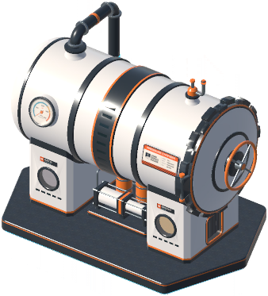
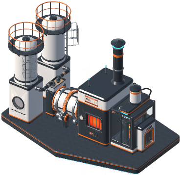
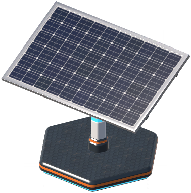
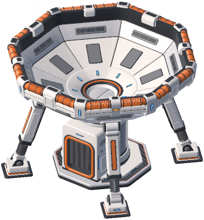
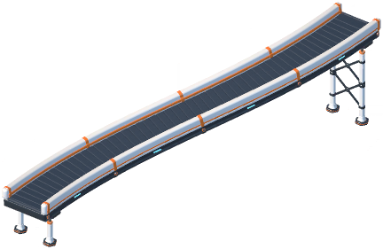

# Structure style guide

How modded structures (machines, generators, anything StructureLib builds from a donor) should look so they sit next to
the vanilla ones, and how to model them with `kit.py`. Vehicles have their own page, [`vehicles/STYLE.md`](../../vehicles/STYLE.md);
the palette is the same.

## The vanilla structures

Card pictures from the game's build menu (dumped by StructureLib's `[Dev] DumpCards`):

| Pressure chamber (96) | Stone press (97) | Solar post (93) |
|---|---|---|
|  |  |  |

| Capsule catcher (100) | Conveyor belt (1000) |
|---|---|
|  |  |

- **Pressure chamber**: a big horizontal white pressure drum banded with black and orange rings, with a round door, a
  hand wheel and a dial, lying on two white pedestals. It all stands on a dark angular base plate with an orange edge.
- **Stone press**: a row of units on one long dark base plate. Two tall white silos with orange railed tops feed a
  white-and-orange rotating drum, then a black furnace box with a glowing orange window, a black chimney and a small
  white tank.
- **Solar post**: one large dark-blue PV panel in a steel frame, tilted on a short white post with a cyan band. The
  post stands on a dark hexagonal foot trimmed with orange and a cyan glow line underneath.
- **Capsule catcher**: a wide white octagonal dish, its rim lined with orange ribbed pads, held up by four splayed
  white legs. The legs end in black screw jacks on small feet, around a central white box with an orange-grilled
  panel.
- **Conveyor belt**: a dark slatted belt between white side rails capped with orange bands and small cyan lights,
  carried on white trestle legs with black feet.

What they share: clean white panels with soft bevels; **dark (black plastic) base plates and housings**; orange on
rims, bands, moving or hot parts (the drum, the furnace window, the catcher's pads); steel only for frames and
fittings; one or two small cyan lights. Detail comes from stacked simple shapes (cylinders, boxes, rings), not
texture. They are friendly industrial kit, slightly toy-like, never rusty and never sci-fi.

## Palette and shapes

Use only the kit's materials (the loader maps the names to the game's own): `MS_BodyWhite` (panels, tanks, pedestals),
`MS_BlackPlastic` (base plates, skirts, housings, hopper mouths), `MS_OrangeMetal` (bands, intake lips, moving or
hot parts), `MS_LampOrange` (glowing windows, an intake ring), `MS_Steel` (frames, rails, chutes, fittings),
`MS_Glass` (windows, PV glass), `MS_Cyan` (one status light, or a thin glow band), and for cargo models only
`MS_Sand` (pressed sand, matte; StructureLib makes it from the colour, no game material has it). `kit.export` refuses
anything else.

- **Structures are boxy industrial units on a visible skid or foot**: a dark plate or skid under everything, a few
  clear white volumes on it. No floating parts.
- **Ports read as a hopper mouth (input) or a chute (output) at the exact port position**: `kit.hopper` puts the rim
  centre on the port; `kit.chute` puts the lip on it. A player should see where the belt goes without a label.
- Custom models hide every donor renderer, including the animated ones (the press's fill planes, emission, tracker
  tilt), so show status with static geometry instead: a cyan `MS_Cyan` light, an orange `MS_LampOrange` ring at the
  intake.

## Footprint, height, budget

Keep the model inside its donor's footprint and height (research/STRUCTURES_RECON.md, "Belts and ports (M1,
2026-11-02)" fact (e)). The game stores them in Unity axes; in Blender `halfFootprint (x, z)` is the half size along
X and Y, and a Unity point `(x, y, z)` is Blender `(-x, -z, y)`.

| Donor | half footprint (Blender X, Y) | height | renderer bounds (Unity min / max) | ports (Unity position, direction) |
|---|---|---|---|---|
| Pressure chamber (96) | 4.11, 2.63 | 6.16 | (-4.08, 0.00, -2.60) / (4.08, 6.17, 2.60) | `IN` (-2.95, 0.85, 0.00); `OUT` (2.95, 0.85, 0.00); both dir (1, 0, 0) |
| Stone press (97) | 4.63, 3.22 | 6.14 | (-4.60, -0.49, -3.19) / (4.60, 6.16, 3.19) | `IN_DUST` (-4.10, 0.85, -1.25); `IN_SAND` (-4.10, 0.85, 1.25); `OUT` (3.90, 0.85, 0.00); all dir (1, 0, 0) |
| Solar post (93) | 0.91, 0.64 | 1.44 | (-0.89, 0.00, -0.61) / (0.89, 1.46, 0.61) | none |

- Floor at Z = 0. The loader puts the model's lowest vertex at structure-local y = 0 (where the chamber's and the
  post's meshes start; not on the donor's lowest renderer bound, which for the press is its buried foundation at
  -0.49), and the game adds the definition's `floorOffset` (0.02) to the placed root, so nothing may hang
  below the skid; build scripts assert `kit.bounds(root)[0].z >= -0.01`.
- Belt ports sit at the belt deck height, **0.85 m** (every vanilla port has y = 0.85), on the footprint edge. A belt
  snaps within 0.05 m of the port (`PortTolerance`) and reaches 1.2 m (`PortReach`). When the port lies within 1 cm of
  the footprint edge, the hopper (or chute) may sit inboard of it, so the geometry stays inside the footprint; the port
  empty itself stays on the edge, where the belt ends.
- Draw the donor box with `kit.footprint_guide(half_x, half_y, height, root)`; it renders as a yellow wireframe and
  never reaches the `.bin`.
- **Under 10,000 triangles** per structure. `kit.preview(..., structure=True)` prints `TRIANGLES <n>` and raises above
  that. Bevels count: prefer `bevel=0` on small repeated parts.

## Ports in the model

A port is an empty named `Port_<name>` (the name the game shows, e.g. `Port_Sand in`), parented under the root:

```python
kit.port("Sand in", (4.1, 0, 0.85), (-1, 0, 0), False, "Sand", root)          # input: +Y points into the machine
kit.port("Coalite out", (-4.1, 0, 0.85), (-1, 0, 0), True, "ryanhartwig.coalite", root)  # output: out of it
```

- Position = the empty's position (where the belt end snaps). Local **+Y = the flow direction**: into the machine for
  an input, out of it for an output (the game's own ports use the belt's flow direction for both).
- ID properties `output` (0.0 or 1.0) and `cargo` (`Sand`, `Dust`, `Stone` or a cargo id). The exporter writes every
  object's ID properties (`obj.keys()`, skipping `_`-prefixed keys) as node props, which StructureLib reads.
- `python shared/blender/check_bin.py <file.bin>` (or `"<blender.exe>" -b --factory-startup --python
  shared/blender/check_bin.py -- <file.bin>`) prints every node, its props and triangles, and for `Port_*` nodes the
  position and flow direction in Unity axes (`rootpos=`, `dir=`): what the loader will see. Blender +Y is Unity -Z.

## Canister models

A modded cargo may bring its own model for the near canister view (`CargoDefinition.CanisterModel`, a `.bin` beside
the mod's DLL): StructureLib builds it under the view in place of the game's dust capsule, on belts, on the ground
and in the hand, with the capsule's renderers hidden and its colliders kept. Far canisters (beyond about 100 m,
drawn instanced) stay the capsule. `mods/SandPower/blender/coalite.py` is the worked example;
`examples/ExampleStructure/blender/example_grit.py` the smallest one.

- **The model's origin is the view's origin.** The capsule's meshes span the box below in view space (Unity axes,
  read in game by the library's one-time `Vanilla canister view` log line); the view's scale is 1. Blender Z is Unity
  Y, so floor the model at Z = 0 and keep it inside the box, in plan and height: a canister then takes the same room
  on a belt and against the walker's hand as the capsule whose colliders it keeps.
- No ports, no footprint guide, no skid: a cargo model is one small solid. Keep it under a few hundred triangles (a
  belt may show dozens at once).
- `kit.preview(root, ..., structure=True, figure=False)` renders it on the ground plane without the 1.8 m figure.

| Vanilla capsule part (view space, Unity x, y, z; measured 2026-11-04) | min | max |
|---|---|---|
| Body (`Graphite`, `Ivory`): the capsule shell | (-0.18, 0.01, -0.21) | (0.18, 0.61, 0.21) |
| `Orange` bands and handle | (-0.18, 0.07, -0.18) | (0.18, 0.61, 0.18) |
| `Rubber` foot | (-0.17, 0.00, -0.19) | (0.17, 0.01, 0.19) |
| `Glass` window and `Dust` fill | (-0.16, 0.13, -0.16) | (0.16, 0.45, 0.16) |
| `Stone block` (shown for stone cargo instead of the capsule) | (-0.25, 0.00, -0.25) | (0.25, 0.28, 0.25) |

So a canister model fits a 0.36 x 0.42 m footprint (x by z) and 0.61 m of height from the origin; a block the size
of the stone block (0.5 x 0.5 m, 0.28 m tall) is the game's own precedent for a non-capsule canister. In Blender
that box is X ±0.18, Y ±0.21, Z 0..0.61.

## Running a build

One headless Blender process per script, from the repo root, never the Blender MCP:

    "C:\Users\ryguy\projects\moonsweep\.downloads\blender-4.5\blender-4.5.15-windows-x64\blender.exe" -b --factory-startup --python mods/<Mod>/blender/<name>.py

(or `"C:\Program Files\Blender Foundation\Blender 4.5\blender.exe"` where Blender is installed). A script does
`kit.reset()`, builds under `kit.root("<Name>_Root")`, draws the footprint guide, then `kit.save(...)`,
`kit.preview(root, ..., structure=True)` and `kit.export(root, ...)`. `shared/blender/smoke_structure.py` is a
complete small example and the kit's self-test (writes to the git-ignored `shared/blender/_smoke/`).

## Preview review checklist

Read all four PNGs (`hero`, `side`, `front`, `rear`) before calling a model done:

1. It stands on the ground plane: skid or foot touching, nothing sunk or floating.
2. It fits the yellow footprint box, in plan and height.
3. Scale reads right against the 1.8 m figure beside its +X side (hidden in the side view).
4. Every input has a visible hopper mouth and every output a chute, exactly where the port is; the port arrows are not
   rendered, so check positions with `check_bin.py`.
5. Palette only, white dominant, dark base, orange where things move, heat or take material in, one cyan light.
6. `TRIANGLES` under 10,000; `check_bin.py` shows each `Port_*` with the right `output`, `cargo` and `dir`.
7. It looks like it belongs next to the cards above: same chunky bevels, same simple stacked shapes.
